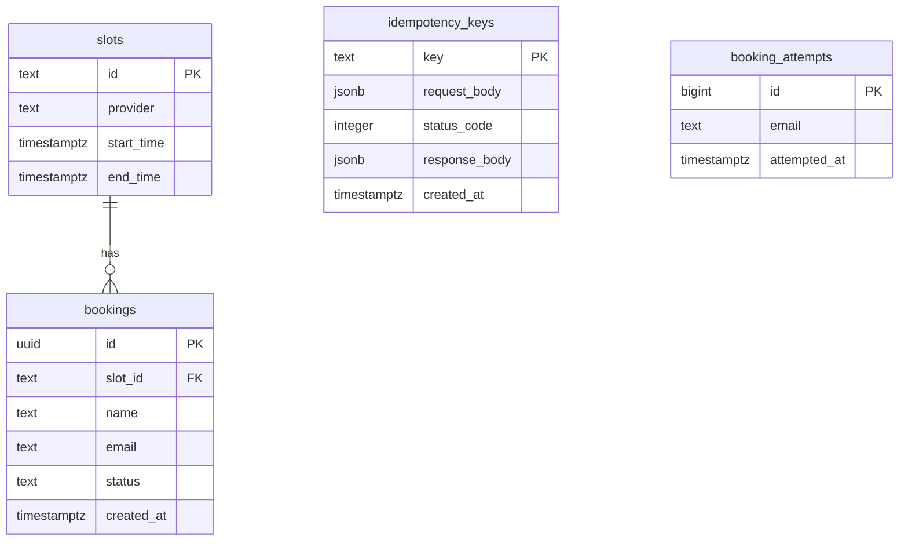

# Clinic Booking API

**Live demo:** [your-vercel-url-here](https://your-vercel-url-here) \
**API docs:** [your-docs-url-here](https://your-docs-url-here) (endpoints, request and response models)

## Overview

This is a clinic booking system made of a simple web page and an API. Patients can view available appointment slots, book one, see a confirmation, and cancel or look up their bookings. It was built in five levels:
- **Level 1:** List slots, book one, and look up a booking
- **Level 2:** API key protection and validation of booking details
- **Level 3:** No double booking, even at the exact same moment, plus cancellations
- **Level 4:** Safe retries with no duplicate bookings, and paged booking lists
- **Level 5:** Spam protection on bookings

> [!NOTE]
> **Why there's no "add slots" screen:** The API has no endpoint that only adds a slot. The only way to load slots is `POST /api/reset`, which deletes every booking and slot before adding the new ones. It's meant for setting up a clean test state, so the web page leaves it out on purpose.

## Tech Stack

| Part | Tool |
|---|---|
| API | FastAPI (Python) |
| Database | Supabase (PostgreSQL) |
| Frontend | HTML, CSS, and JavaScript |
| Deployment | Vercel |

## Project Structure

```text
xyz clinic/
├── api/ # Backend service
│   ├── tests/ # API checks
│   │   ├── checker.py # API check script
│   │   ├── test_concurrency.py # Race tests
│   │   └── test_idempotency.py # Retry tests
│   ├── database.py # Data access
│   ├── main.py # API entry
│   ├── schema.py # Request and response models
│   └── utils.py # Shared helpers
├── public/ # Frontend pages
│   ├── app.js # Browser logic
│   ├── index.html # Booking page
│   └── styles.css # Page styling
├── .vercelignore # Vercel ignore list
├── Readme.md # Project notes
└── requirements.txt # Python packages
```

## Running the Project

### 1. Setup

Copy `.env.example` to a new file called `.env` and fill in your own values. It lists everything the API needs: your Supabase URL, your Supabase key, and the API key that requests must send in the `X-API-Key` header.

```bash
cp .env.example .env
```

### 2. The API

Requires Python 3.11.18.

```bash
pip install -r requirements.txt
uvicorn main:app --reload
```

The API runs at `http://127.0.0.1:8000`.

### 3. The checker

The checker tests the API against all five levels. It needs `httpx`:

```bash
pip install httpx
python checker.py --base-url http://127.0.0.1:8000 --api-key YOUR_X_API_KEY
```

| Option | What it does |
|---|---|
| `--base-url` | Where the API is running |
| `--api-key` | The same key you set in `.env` |
| `--level` | Which levels to run: `all` (default), one like `3`, or a range like `1-3` |
| `--yes` | Required when testing a deployed API, not a local one |

> [!WARNING]
> The checker calls `POST /reset`, which wipes all data on the target API.

### 4. The full app

With the API running, open `index.html` in your browser.

## Database

The project uses a Supabase (PostgreSQL) database with four tables in two groups.

| Group | Table | Purpose |
|---|---|---|
| Core data | `slots` | Appointment slots: id, provider, start and end time |
| Core data | `bookings` | Patient bookings: id, slot, name, email, status (`confirmed` or `cancelled`), created time |
| Supporting | `idempotency_keys` | Prevents duplication from retries: by saving each request key, body, and response |
| Supporting | `booking_attempts` | Rate limiting: Logs every booking attempt per email to enforce 5 attempts per minute |



**Why this design:** Slot details live only in `slots` and booking details only in `bookings`, linked by `slot_id`. This avoids update, and deletion anomalies.

### Functions and rules

| Name | What it does |
|---|---|
| `uid_confirmed_slots` | Allows only one confirmed booking per slot, even under simultaneous requests |
| `check_rate_limit(email)` | Limits each email to 5 attempts per minute and returns the time left if over |
| `reset_and_insert_slots(slots)` | Powers `POST /reset`: clears all data and loads the new slots in one step |

> [!NOTE]
> Both functions can only be run by the API's server-side `service_role`.